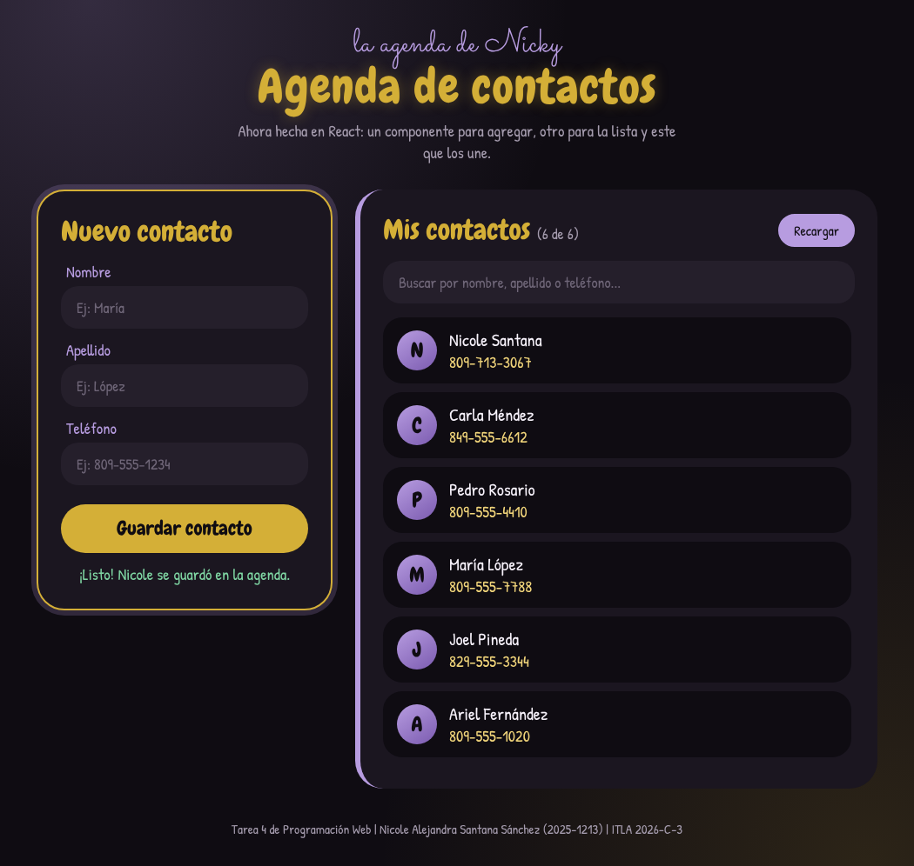

-----Agenda React-----

Tarea 4 de Programación Web - ITLA
Nicole Alejandra Santana Sánchez - 2025-1213

Pues esta es la misma agenda de la tarea 3, pero ahora hecha en React con Vite. Cuando abres la página, con fetch se traen todos los contactos del servidor del profe (raydelto.org/agenda.php) usando GET, y se guardan en un estado con useState. El useEffect es para que eso pase una sola vez, cuando la página carga.

¿Y cómo está dividida? Pues en tres componentes. ListaContactos es el que muestra la lista, AgregarContacto es el del formulario, y App es el componente padre que tiene a los dos adentro. O sea, App es el que guarda los contactos y se los pasa a los otros dos.

Para agregar uno nuevo llenas el nombre, el apellido y el teléfono, le das a guardar y se manda al servidor con POST. Después la lista se vuelve a cargar y ya te sale arriba. Si se te olvida llenar algo o pones letras en el teléfono, no te deja guardar.

También le dejé el buscador de la tarea 3, porque son muchísimos contactos y así es más fácil encontrar a alguien.

Para correrlo hay que tener Node.js instalado y poner en la terminal:

npm install
npm run dev

